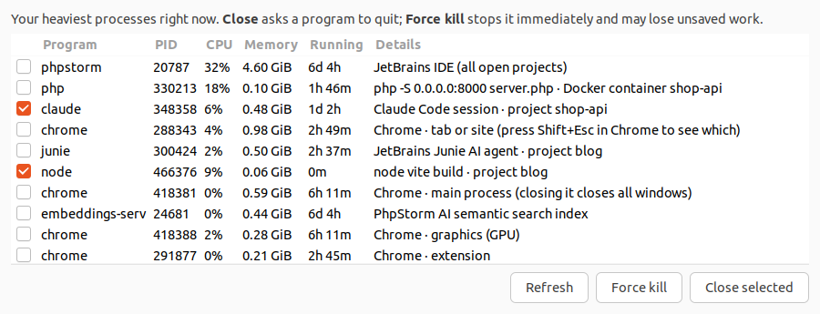

# cpu-mem-alert

A small Linux desktop monitor that pops up an alert when CPU or memory usage stays high, and helps you find and close the programs causing it.

## Alert popup


- Two columns: **Processor** (usage + top 5 processes by CPU) and **Memory** (usage, GiB used + top 5 processes by RAM).
- Each value is green below the threshold, orange above it, and **red at 95%+**. The border takes the worst color.
- An alert fires after usage stays above the threshold for 3 samples in a row, then waits 5 minutes before alerting again.
- The popup sits in the top-right corner, closes on click, and disappears after 15 seconds.

## Programs to close

Click **Show programs to close** in the popup to see what is weighing on your machine and free it up in a few clicks.



- Lists your 15 heaviest processes right now, ranked by live CPU + memory.
- The **Details** column says what each process actually is:
  - Claude Code, Junie or any dev tool: the **project** it runs in
  - Processes inside Docker: the **container** name
  - Chrome / Electron apps: the **role** of the process (tab, extension, GPU, network, main process…)
  - IDEs and their helpers (e.g. PhpStorm's AI semantic search index)
- Hover a row for the full command and folder.
- Tick processes, then **Close selected** (asks them to quit cleanly) or **Force kill** (stops them immediately, may
  lose unsaved work). The list refreshes on its own afterwards.
- Safe by design: only your own processes are listed. Root processes (security agents, system services), core desktop
  processes (GNOME Shell, audio…), FortiClient and the monitor itself are never shown.
- Chrome does not reveal which tab a process belongs to; press **Shift+Esc** in Chrome to see that.

Open it any time, without waiting for an alert:

```bash
cpu-alert-popup --candidates
```

## Requirements

- Linux with a graphical session and systemd (tested on Ubuntu 22.04, GNOME on Wayland)
- Python 3 with GTK3 bindings: `sudo apt install python3-gi gir1.2-gtk-3.0`
- XWayland when running on Wayland (enabled by default on GNOME)

## Install

```bash
curl -fsSL https://raw.githubusercontent.com/hbenabdallah/cpu-mem-alert/main/install.sh | bash
```

Or from a clone:

```bash
git clone https://github.com/hbenabdallah/cpu-mem-alert.git
cd cpu-mem-alert
./install.sh
```

This copies the scripts to `~/.local/bin`, installs a systemd user service, and starts it. No root needed.

Uninstall:

```bash
curl -fsSL https://raw.githubusercontent.com/hbenabdallah/cpu-mem-alert/main/install.sh | bash -s -- --uninstall
```

(or `./install.sh --uninstall` from a clone)

## Test it

Show the popup with sample values:

```bash
~/.local/bin/cpu-alert-popup 97 75 $'97.0%\tphp' 82 75 $'3.2G\tphpstorm' "26 / 31 GiB used"
```

Or trigger a real alert: run a quick monitor in one terminal and load every core in another.

```bash
CPU_ALERT_SUSTAIN=1 CPU_ALERT_COOLDOWN=30 ~/.local/bin/cpu-alert     # terminal A
for i in $(seq $(nproc)); do yes > /dev/null & done                  # terminal B
```

A red popup appears within a few seconds; open **Show programs to close**, tick the `yes` processes and close them
(or run `pkill yes`).

## Configuration

Set these environment variables in the service (`systemctl --user edit cpu-alert`, then add `Environment=NAME=value` under `[Service]`):

| Variable | Default | Meaning |
| --- | --- | --- |
| `CPU_ALERT_THRESHOLD` | 75 | CPU % that counts as high |
| `MEM_ALERT_THRESHOLD` | 75 | Memory % that counts as high |
| `CPU_ALERT_CRITICAL` | 95 | % at which the popup turns red |
| `CPU_ALERT_INTERVAL` | 5 | Seconds between samples |
| `CPU_ALERT_SUSTAIN` | 3 | High samples in a row before alerting |
| `CPU_ALERT_COOLDOWN` | 300 | Seconds between two alerts |
| `CPU_ALERT_POPUP_TIMEOUT` | 15 | Seconds the popup stays on screen |

Logs: `journalctl --user -u cpu-alert -f`
